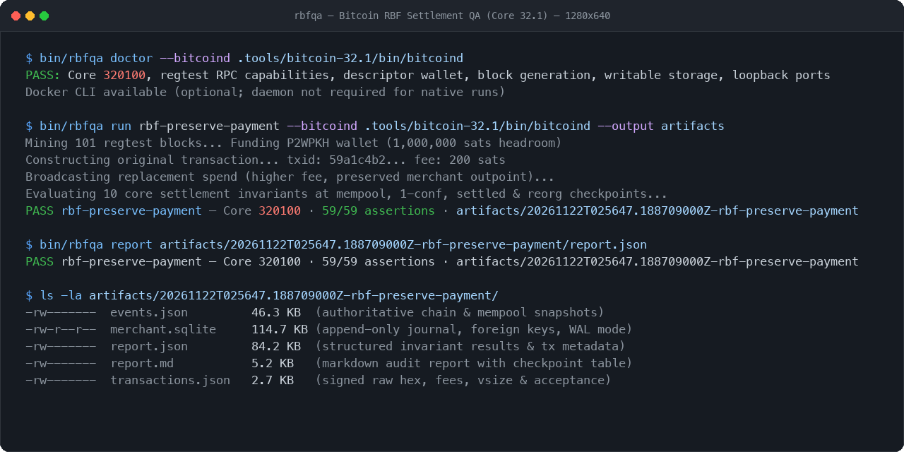
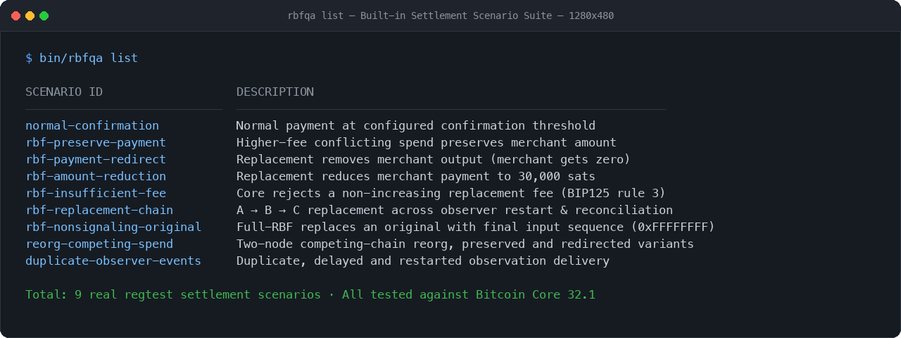
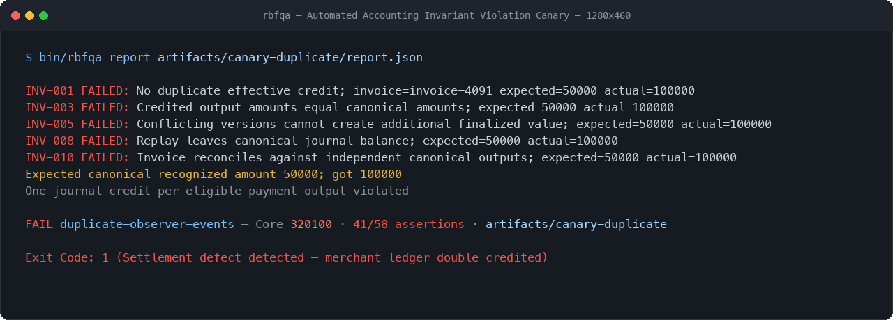
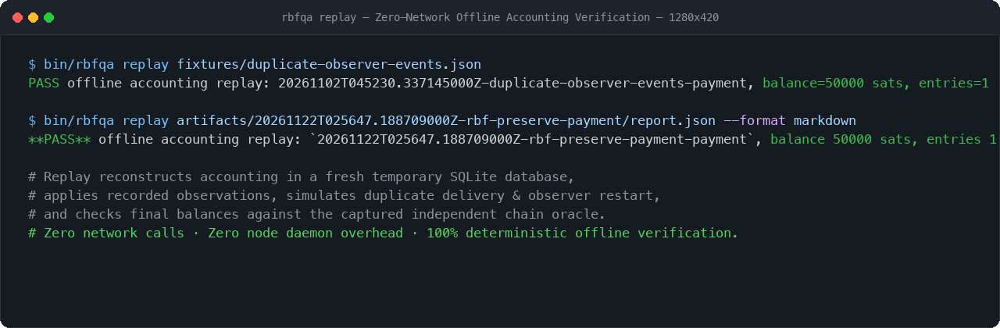
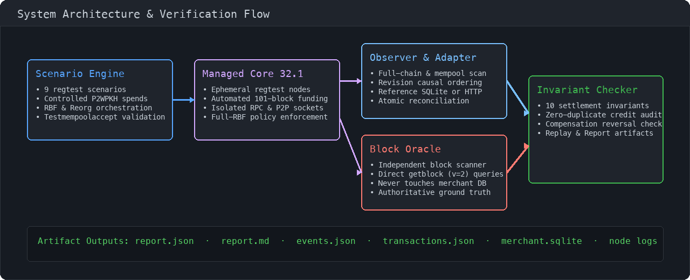

# Bitcoin RBF Settlement QA

A local Go CLI and verification framework that tests Bitcoin merchant accounting against real Bitcoin Core regtest transactions, mempool replacements (Replace-By-Fee), and competing-chain reorganizations. It targets invoice backends, deposit processors, exchanges, and checkout infrastructure that need to preserve absolute accounting correctness when transaction identities or canonical blocks change.

The tool constructs and signs controlled P2WPKH spends, drives isolated Bitcoin Core nodes, observes inputs and receiving outputs, and compares a merchant's journal with an independent scan of the active blockchain. It is a settlement verification tool, not a wallet or payment gateway.



---

## The Problem It Solves

When users or payment counterparties bump transaction fees via Replace-By-Fee (RBF) or when blockchain reorgs swap canonical blocks, naive merchant backends frequently commit catastrophic accounting errors:

- **Double Crediting**: Crediting both the original transaction and its replacement spend.
- **Premature Crediting**: Crediting unconfirmed transactions or transactions below the configured confirmation threshold.
- **Redirected Payment Theft**: Treating a replacement transaction that redirected funds elsewhere as a valid merchant payment.
- **Overcredited Reductions**: Settling the full original invoice amount after a replacement transaction reduced the paid value.
- **Orphan Retention**: Keeping an orphaned credit after a chain reorganization without posting a compensating reversal.
- **Webhook / Replay Duplication**: Duplicating credits when receiving repeated observer notifications or during reconciliation restarts.
- **Lost Invoice Associations**: Losing track of an invoice when the confirmed transaction hash differs from the initial unconfirmed spend.

This tool automates adversarial regtest scenarios, exercises real mempool replacements, and enforces 10 strict settlement invariants at every transaction checkpoint.

---

## Visual Showcase & Feature Gallery

### 1. Live Execution & Scenario Run

Spinning up an ephemeral Bitcoin Core 32.1 regtest node, generating 101 funding blocks, broadcasting replacement spends, verifying 59 invariant assertions, and saving structured audit artifacts.


### 2. Built-in Scenario Catalog

Nine targeted regtest scenarios covering standard confirmations, fee bumps, redirects, amount reductions, fee rejections, replacement chains, full-RBF, multi-node chain reorgs, and duplicate observer replay.



### 3. Automated Invariant Violation Detection

Demonstration of `rbfqa` catching an intentional double-credit defect in a faulty HTTP merchant backend:



### 4. Zero-Network Offline Accounting Replay

Replaying captured chain observations and merchant journal mutations in an isolated temporary SQLite database to verify deterministic replayability without node or network overhead:



### 5. System Architecture & Verification Flow

How the scenario engine, managed Bitcoin Core daemons, full-snapshot observer, merchant adapters, SQLite journal, and independent block oracle work together:



---

## 10 Core Settlement Invariants

Every scenario run evaluates a strict set of settlement invariants against the merchant ledger at multiple checkpoints (`original-mempool`, `replacement-observed`, `first-confirmation`, `settled`, `canonical-confirmation`, `repeat-reconciliation`):

| Invariant   | Rule                                   | Verification Method                                                                         |
| ----------- | -------------------------------------- | ------------------------------------------------------------------------------------------- |
| **INV-001** | **No duplicate effective credit**      | Active credits per eligible outpoint must equal exactly 1.                                  |
| **INV-002** | **Active-chain output correspondence** | Every journal credit must correspond to a verifiable output on the active chain.            |
| **INV-003** | **Exact output amount match**          | Credited journal values must exactly equal the satoshi amounts from canonical outputs.      |
| **INV-004** | **Confirmation threshold enforcement** | Unconfirmed outputs or outputs below threshold must never settle.                           |
| **INV-005** | **No additional value from conflicts** | Conflicting transaction versions must not inflate total recognized balance.                 |
| **INV-006** | **Redirected spend neutralization**    | Replaced spends that omit the merchant address must result in zero balance.                 |
| **INV-007** | **Compensating reversals for orphans** | Reorganized or replaced outpoints must receive valid compensating reversal journal entries. |
| **INV-008** | **Replay consistency**                 | Offline re-delivery of historical events must reproduce the canonical journal balance.      |
| **INV-009** | **Authoritative tip agreement**        | Merchant checkpoint tip must match the independent chain oracle's best block hash.          |
| **INV-010** | **Independent oracle reconciliation**  | Net merchant balance and outstanding invoice amounts must match the independent block scan. |

---

## Scenario Catalog

| ID                          | Test Scenario                          | Settlement Challenge Tested                                                       |
| --------------------------- | -------------------------------------- | --------------------------------------------------------------------------------- |
| `normal-confirmation`       | Normal payment at configured threshold | 50,000 sats, threshold enforcement, repeated reconciliation                       |
| `rbf-preserve-payment`      | Preserved payment replacement          | Conflicting spend with higher fee preserves merchant output value                 |
| `rbf-payment-redirect`      | Payment redirection                    | Replacement redirects input funds to third-party; merchant balance must drop to 0 |
| `rbf-amount-reduction`      | Partial amount reduction               | Replacement reduces output to 30,000 sats; merchant balance must adjust           |
| `rbf-insufficient-fee`      | Insufficient replacement fee           | Core rejects an equal-fee conflicting spend; original transaction settles         |
| `rbf-replacement-chain`     | Multi-version replacement chain        | A → B → C successive replacements surviving observer restarts                     |
| `rbf-nonsignaling-original` | Full-RBF non-signaling spend           | Replaces an original spend with sequence `0xFFFFFFFF` under modern full-RBF       |
| `reorg-competing-spend`     | Competing-chain reorganization         | Two isolated Core nodes mine competing branches; verifies reorg credit reversals  |
| `duplicate-observer-events` | Observer fault tolerance               | Duplicate webhook delivery, stale revisions, observer crash, and replay           |

See [docs/scenarios.md](docs/scenarios.md) for full preconditions and assertions.

---

## Quick Start

Requires Go 1.24+ and Bitcoin Core **32.1**. Linux and macOS (Apple Silicon and Intel) are supported. No hosted nodes, third-party APIs, or real coins are required.

### 1. Clone and Install Core 32.1

```sh
git clone https://github.com/ranajahanzaib/bitcoin-rbf-settlement-qa.git
cd bitcoin-rbf-settlement-qa

# Downloads official release and verifies pinned SHA-256 digest
sh scripts/install-core.sh .tools/bitcoin-32.1
```

### 2. Build the CLI

```sh
# Using make:
make build

# Or directly with Go:
go build -trimpath -o bin/rbfqa ./cmd/rbfqa
```

### 3. Verify Environment (`doctor`)

```sh
bin/rbfqa doctor --bitcoind "$PWD/.tools/bitcoin-32.1/bin/bitcoind"
```

### 4. Run a Scenario

```sh
# Run a single scenario
bin/rbfqa run rbf-preserve-payment --bitcoind "$PWD/.tools/bitcoin-32.1/bin/bitcoind"

# Run all 9 scenarios (shares a 10m deadline)
bin/rbfqa run all --bitcoind "$PWD/.tools/bitcoin-32.1/bin/bitcoind" --timeout 10m
```

---

## CLI Reference

```sh
rbfqa COMMAND [ARGUMENT] [flags]
```

### Commands

| Command  | Usage                              | Description                                                                     |
| -------- | ---------------------------------- | ------------------------------------------------------------------------------- |
| `doctor` | `rbfqa doctor [flags]`             | Verify Core 32.1 binary, RPC capabilities, wallet creation, mining, and storage |
| `init`   | `rbfqa init [--config FILE]`       | Write commented `rbfqa.yaml` configuration file (refuses to overwrite existing) |
| `list`   | `rbfqa list [--format FORMAT]`     | List all nine built-in settlement scenarios                                     |
| `run`    | `rbfqa run SCENARIO\|all [flags]`  | Execute isolated real regtest scenarios against reference or HTTP adapter       |
| `replay` | `rbfqa replay REPORT.json [flags]` | Offline event and accounting replay in temporary SQLite database                |
| `report` | `rbfqa report REPORT.json [flags]` | Render saved report in `terminal`, `json`, or `markdown` format                 |

### Flags

| Flag                       | Default     | Description                                                      |
| -------------------------- | ----------- | ---------------------------------------------------------------- |
| `--config FILE`            | `""`        | Path to strict YAML configuration; unknown fields produce errors |
| `--bitcoind PATH`          | `bitcoind`  | Path to Bitcoin Core 32.1 binary                                 |
| `--adapter reference\|URL` | `reference` | Built-in SQLite reference merchant or HTTP adapter URL           |
| `--output DIR`             | `artifacts` | Directory where scenario run evidence and reports are written    |
| `--format FORMAT`          | `terminal`  | Output format: `terminal`, `json`, or `markdown`                 |
| `--timeout DURATION`       | `3m`        | Overall command execution deadline (e.g. `5m`, `10m`)            |
| `--keep-artifacts`         | `false`     | Preserve temporary Core node datadirs and logs                   |
| `--verbose`                | `false`     | Print detailed artifact and diagnostic locations                 |

### Exit Codes

- **0**: All settlement invariants and scenario assertions passed.
- **1**: Merchant settlement invariant or scenario assertion failed.
- **2**: Invalid configuration or unsupported environment (e.g. incompatible Core version).
- **3**: Infrastructure or node execution failure.

---

## Testing Your Own Backend

You can test custom payment gateways, exchanges, or checkout systems by implementing the opt-in [HTTP Adapter Protocol](docs/adapter-protocol.md).

```text
rbfqa runner ──HTTP──> Your Adapter ──> Your Merchant Database
     │                                           │
     └── Independent Core Block Oracle ──────────┘
             (compares ground truth against your ledger)
```

### Example QA Bridge

A working reference HTTP adapter is included in `examples/merchant-adapter`:

```sh
# Terminal 1: Start the reference adapter with an isolated SQLite DB
go run ./examples/merchant-adapter --db /tmp/rbfqa-example.sqlite --listen 127.0.0.1:8787

# Terminal 2: Run a scenario against your HTTP service
bin/rbfqa run rbf-preserve-payment \
  --adapter http://127.0.0.1:8787 \
  --bitcoind "$PWD/.tools/bitcoin-32.1/bin/bitcoind"
```

Set `RBFQA_ADAPTER_TOKEN` if your service requires bearer token authentication.

---

## Generated Evidence & Artifacts

Every test run generates a timestamped directory under `artifacts/<run-id>/` containing complete, auditable proof:

```text
artifacts/20261122T025647.188709000Z-rbf-preserve-payment/
├── events.json           # Authoritative chain and mempool observation snapshots
├── merchant.sqlite       # Complete merchant journal database (WAL mode)
├── node-a-debug.log      # Raw Bitcoin Core daemon debug log
├── node-a-process.log    # Daemon process stdout/stderr
├── report.json           # Machine-readable report with all invariant checks
├── report.md             # Formatted Markdown report with audit table
└── transactions.json     # Decoded transactions, signed raw hex, fees, and vsize
```

### Offline Replay

You can verify any previously captured run report offline without running Bitcoin Core or having network access:

```sh
bin/rbfqa replay artifacts/RUN/report.json
```

---

## Docker Execution

A reproducible container environment with pinned Core 32.1 is available:

```sh
# Build container image
docker compose -f docker/compose.yaml build

# Run doctor
docker compose -f docker/compose.yaml run --rm qa doctor

# Run full test suite
docker compose -f docker/compose.yaml run --rm qa
```

Run artifacts are preserved in the `evidence` Docker volume.

---

## Development and Verification

```sh
# Run unit tests, vet, and formatting checks
go test -race ./cmd/... ./internal/...
go vet ./...
gofmt -l cmd internal test examples

# Run real Bitcoin Core integration suite (9 scenarios + 2 fault canaries)
RBFQA_BITCOIND="$PWD/.tools/bitcoin-32.1/bin/bitcoind" \
  go test -count=1 -v -timeout 15m ./test/integration
```

---

## Architecture and Design Principles

1. **Independent Oracle Ground Truth**: The checker never relies on the merchant's view of the world. It scans raw blocks directly from Bitcoin Core via RPC (`getblock` verbosity 2) to establish authoritative canonical reality.
2. **Deterministic Append-Only Journaling**: All balance changes are represented as positive credits or compensating reversals referencing the original credit ID. Updates and deletes are blocked by database triggers.
3. **Causal Event Revisions**: Chain observations carry an incrementing monotonic revision number and tip hash, ensuring out-of-order deliveries are safely reconciled.
4. **Isolated Ephemeral Environments**: Each scenario execution creates fresh, isolated temporary datadirs, loopback ports, and P2WPKH descriptor wallets. External wallets and mainnet chains are strictly prohibited.

For technical deep-dives, see:

- [Architecture](docs/architecture.md)
- [Settlement Model](docs/settlement-model.md)
- [Bitcoin Core Compatibility](docs/bitcoin-core.md)
- [Adapter Protocol](docs/adapter-protocol.md)
- [Scenario Details](docs/scenarios.md)
- [Example Failure Analysis](docs/example-failure.md)

---

## License

MIT License. See [LICENSE](LICENSE) for details.
